# OptiLab — 交互式光学成像与性能分析仿真平台

> 面向 **半导体检测设备 / 整机测试 / 光学调试 / 机器视觉 / 软硬件测试** 岗位的个人求职作品：
> 把光学公式、数值仿真与工程测试流程做成一个可交互、可验证的网页仿真平台。

**⚠️ 重要声明**
- 本项目是 **教学与求职作品**，所有虚拟设备、图像、测试记录与性能数据 **均由程序实时仿真生成**，不代表任何真实设备的性能。
- 本项目是 **理想化模型 + 数值仿真**，**不是商业级光学设计软件**（Zemax OpticStudio / Code V / LightTools / COMSOL 等），不可用于产品设计定型。
- 界面中所称「设备」「平台」「测试」均为**仿真对象**，没有对应的实体硬件。

---

## 目录

- [1. 项目背景](#1-项目背景)
- [2. 功能现状](#2-功能现状渐进式开发)
- [3. 界面预览](#3-界面预览)
- [4. 技术栈](#4-技术栈)
- [5. 系统架构](#5-系统架构)
- [6. 数学模型概要](#6-数学模型概要)
- [7. 快速开始](#7-快速开始)
- [8. 质量保障](#8-质量保障)
- [9. GitHub Pages 部署](#9-github-pages-部署)
- [10. 项目局限](#10-项目局限)
- [11. 后续扩展建议](#11-后续扩展建议)
- [12. 学习与技术要点](#12-学习与技术要点)

---

## 1. 项目背景

我的人工智能专业背景偏向 C++ / Python / PLC / 机器视觉与缺陷检测工程，正在系统学习应用光学。
为了把「课本公式」变成「能讲清楚、能验证、能演示」的东西，本项目按工业仪器软件的组织方式实现了一个纯前端光学仿真平台：

- **算法全部本地计算**：无后端、无数据库、无付费 API，浏览器即为计算引擎；
- **计算与界面严格分离**：光学算法是纯函数，可被单元测试直接验证；
- **面向工程测试**：不止「画得好看」，还要有重复性、误差统计、PASS/FAIL 判定与实验报告（后续阶段）。

## 2. 功能现状（渐进式开发）

| 阶段 | 模块 | 状态 | 说明 |
| --- | --- | --- | --- |
| 一 | ① 几何光学与光线追迹 | ✅ 已完成 | 理想薄透镜近轴成像：像距、放大率、实像/虚像、三条主光线、光锥追迹、自动缩放 |
| 一 | ② 光的传播与折射 | ✅ 已完成 | 反射定律、斯涅尔定律、临界角与全反射、菲涅尔反射率、布儒斯特角 |
| 二 | ③ 衍射与光学分辨率 | ✅ 已完成 | 艾里斑解析模型（J₁ 数值计算）、瑞利判据、非相干截止频率、**物方/像方并列换算** |
| 二 | ④ PSF 与 MTF 性能分析 | ✅ 已完成 | 复光瞳 `circ·exp(i2πW₂₀ρ²)` + 自实现二维 FFT → PSF 热力图、MTF 曲线、衍射极限对照、MTF50 |
| 三 | ⑤ 自动对焦与设备性能测试 | ✅ 已完成 | 虚拟 Z 轴平台 + Laplacian/Tenengrad/Brenner + 全范围/粗精搜索 + 重复性统计与 PASS/FAIL |
| 三 | ⑥ 工业视觉成像质量测试 | ✅ 已完成 | 离焦/运动/曝光/噪声/照度/对比度退化 + SSIM、PSNR、清晰度 + 批量扫描曲线 + ONNX 预留接口 |
| 四 | ⑦ 自动化测试报告 | ⏳ 规划中 | CSV/JSON/PNG 导出、可打印报告、光学知识库 |

> 未实现模块在左侧导航中 **可见但禁用并标注「规划中」**，不做「看起来能点、实际没功能」的假按钮。

**阶段一已实现的具体交互能力**

- 深/浅色主题切换（跟随系统偏好 + localStorage 持久化）、工业仪器风格三栏布局 + 底部数据坞（结果 / 曲线 / 日志，高度可拖拽）。
- 几何光学：凸/凹透镜、焦距、物距、物高、通光口径、光锥采样数实时可调；5 个教材预设工况；参数非法实时提示；ECharts 像距–物距与放大率–物距特性曲线。
  - **计算结果按信息层级分三级**：① 核心成像结果（像距 / 放大倍率 / 像高 / 成像性质，大数值卡片，默认展开）→ ② 辅助光学参数（物方焦点 / 像方焦点 / 成像区间，紧凑低权重）→ ③ 高级光学参数（名义 F 数 / 有效 F 数 / 物方 NA / 像方 NA，折叠默认关闭）。
  - **计算过程与公式推导**独立折叠面板（默认关闭），展开后给出公式、数值代入、单位与适用条件。
  - **光路默认只画三条典型光线 + 光轴 + 焦点 + 物 + 像**；虚像反向延长线在虚像时自动以虚线出现；光锥（含 7.5% 透明度的光束填充）作为可选高级辅助，默认关闭，填充层级低于光线、透镜与文字标注。
- 折射：入射角、双侧折射率、波长可调；9 种介质预设；临界角/布儒斯特角参考线；全反射一键演示；光线线宽按实际反射率/透射率加权；菲涅尔 R_s / R_p / R / T 曲线；逐步计算过程展示。
- 每个模块内置「原理与公式 / 适用条件 / 工业应用 / 学习要点」折叠面板。
- 实验日志记录真实参数与计算结果，支持复制导出。

## 3. 界面预览

| 几何光学（深色，默认视图） | 虚像工况（u &lt; f） |
| --- | --- |
| 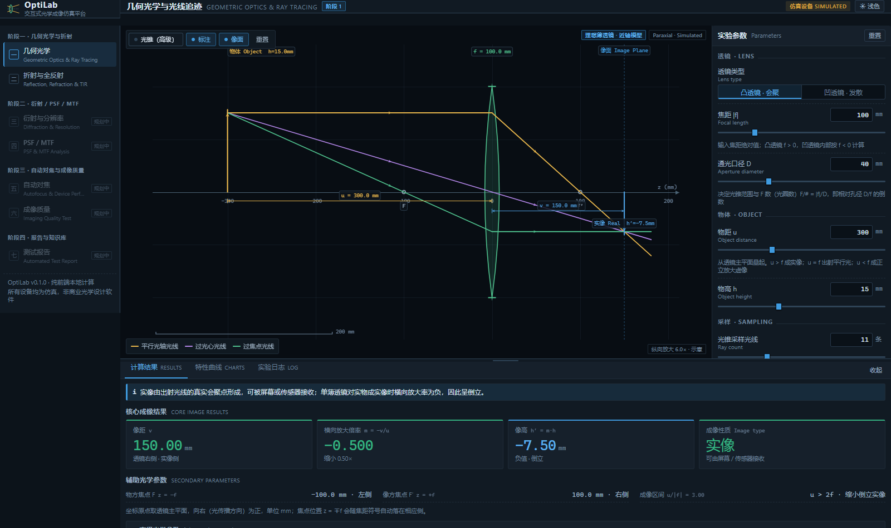 | 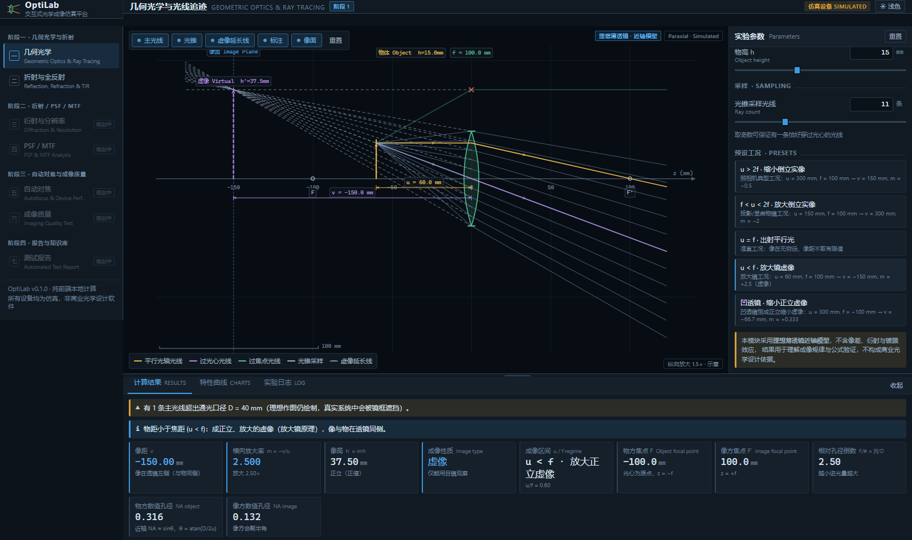 |

| 可选高级辅助：光锥与光束填充 | 特性曲线（ECharts 实算） |
| --- | --- |
| 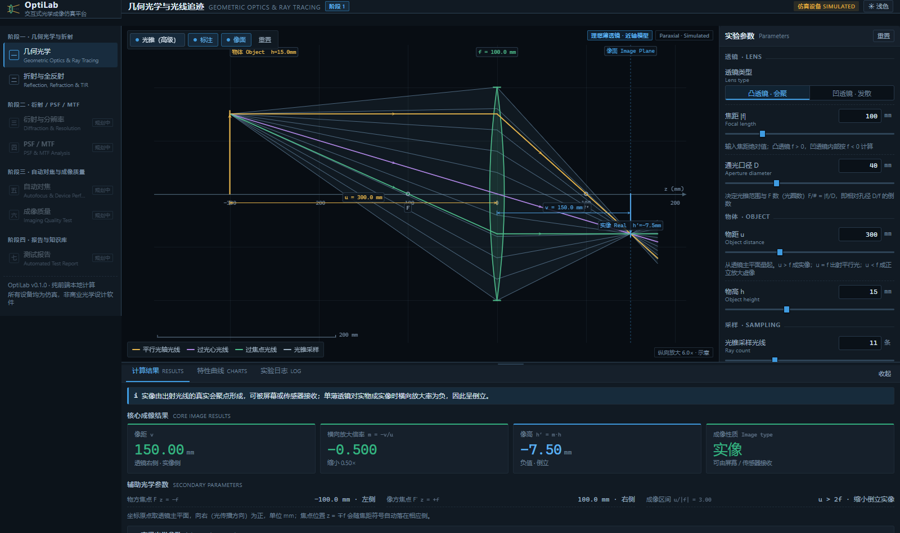 | 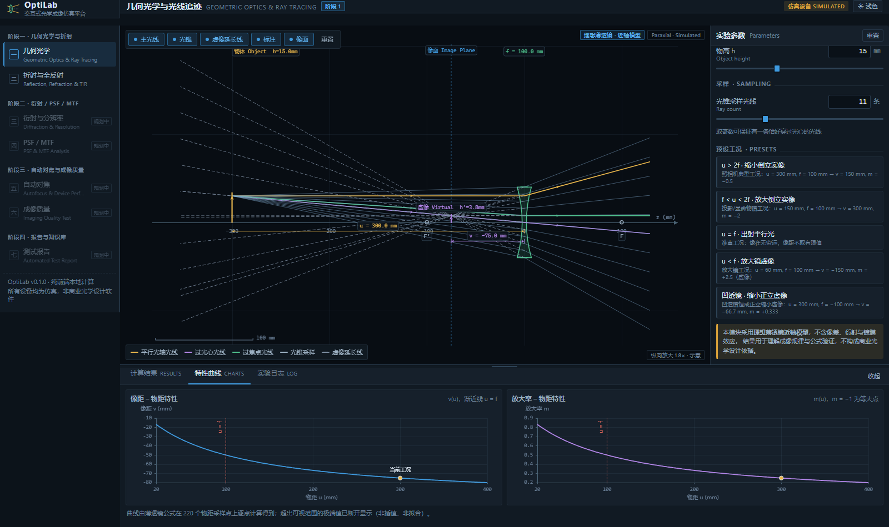 |

| 浅色主题 | — |
| --- | --- |
| 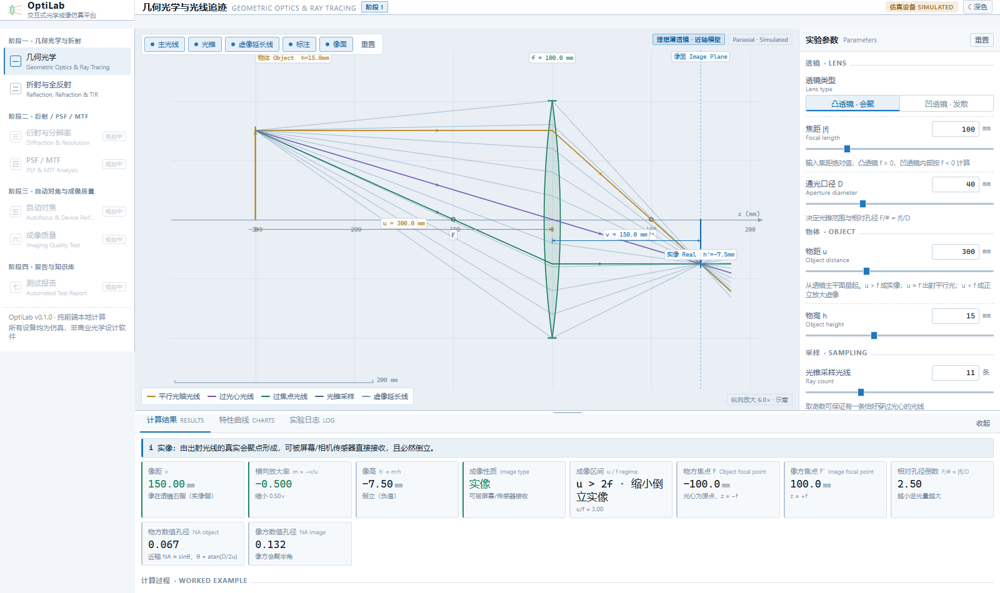 | |

| 自动对焦：虚拟 Z 轴平台 + 搜索结果 | 清晰度–Z 曲线与重复性误差 |
| --- | --- |
| 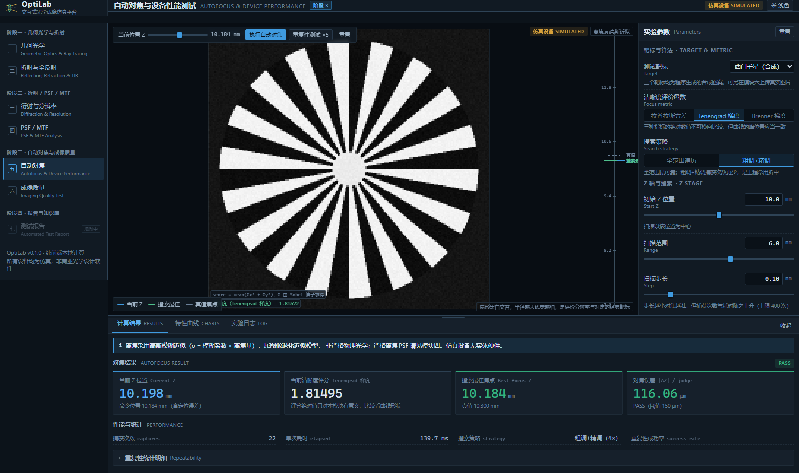 | 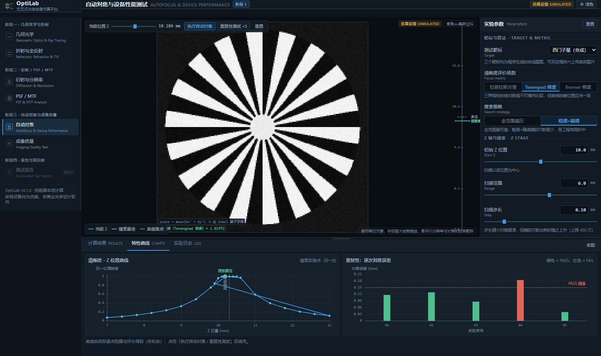 |

| 成像质量：原图 vs 退化图 | 批量扫描与直方图 |
| --- | --- |
| 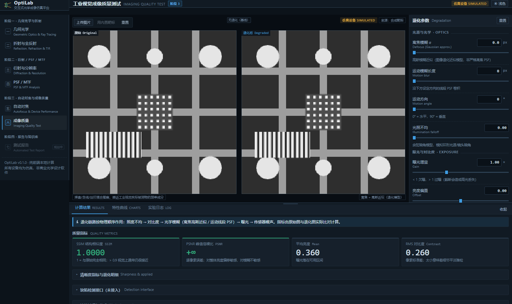 | 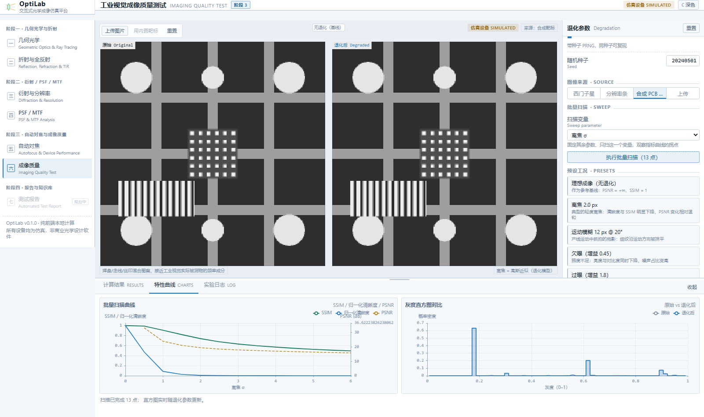 |

| 折射与全反射 | 全反射 TIR |
| --- | --- |
| 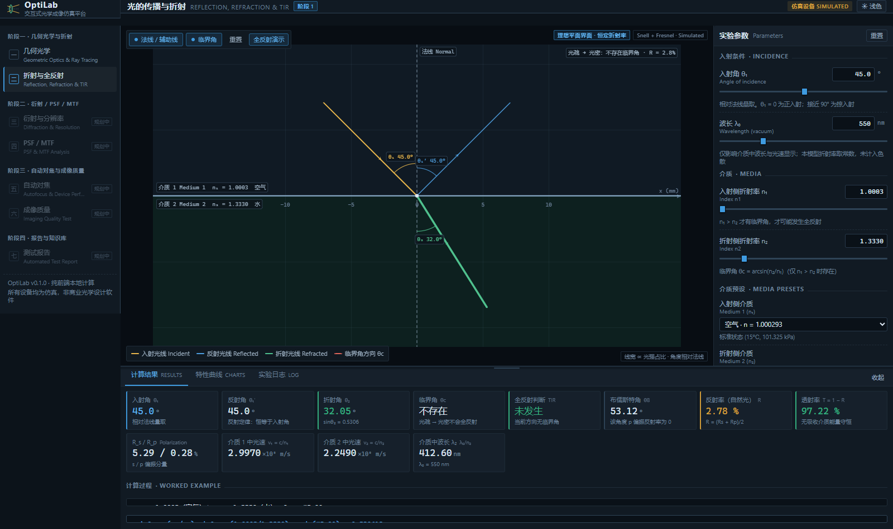 | 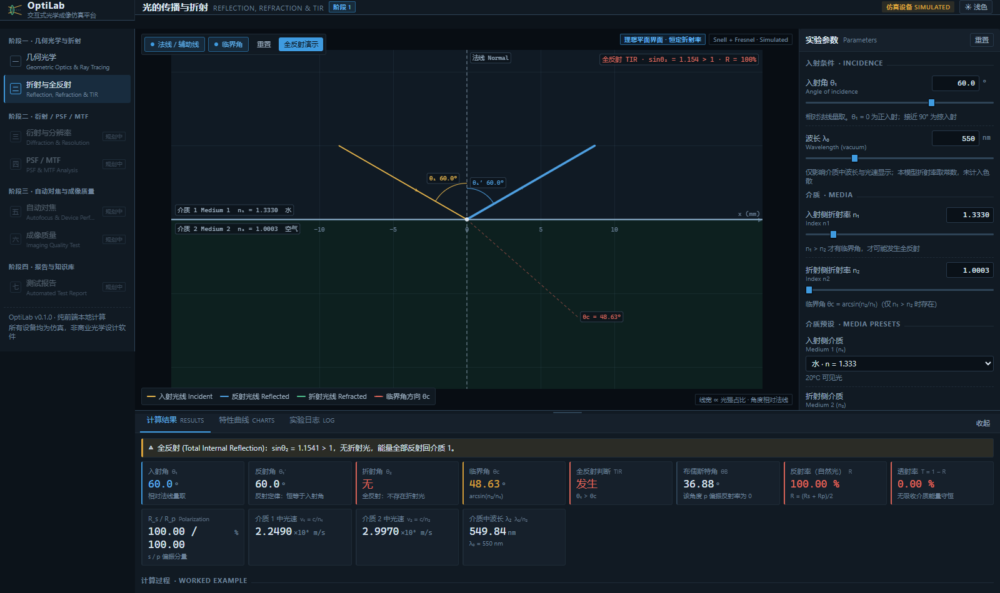 |

| 衍射：艾里斑（对数显示可见暗环） | 径向光强与分辨率家族曲线 |
| --- | --- |
| 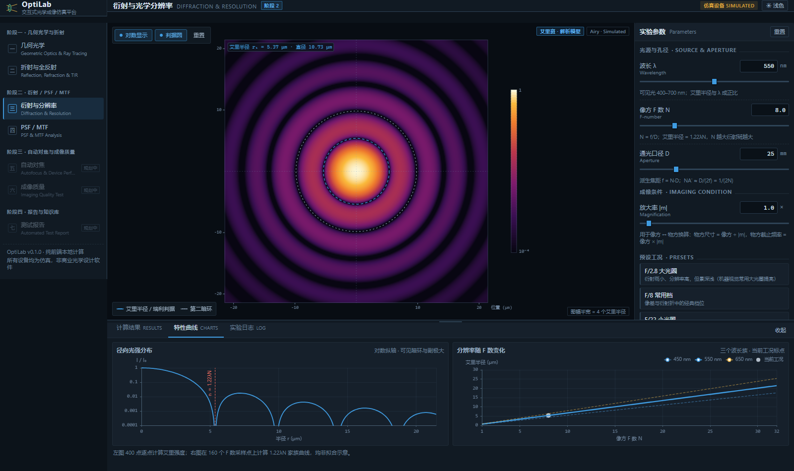 | 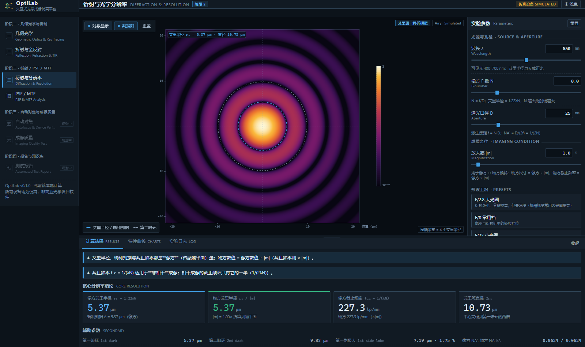 |

| PSF / MTF（F/8 焦平面） | MTF 曲线与衍射极限对照 |
| --- | --- |
| 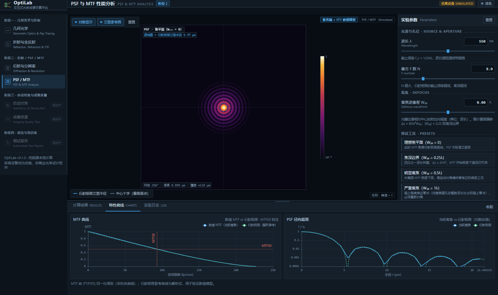 | 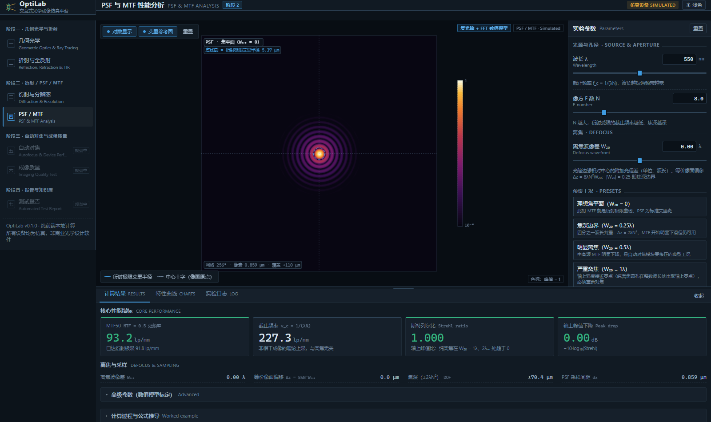 |

| 菲涅尔曲线 | 窄屏（移动端基本浏览） |
| --- | --- |
| 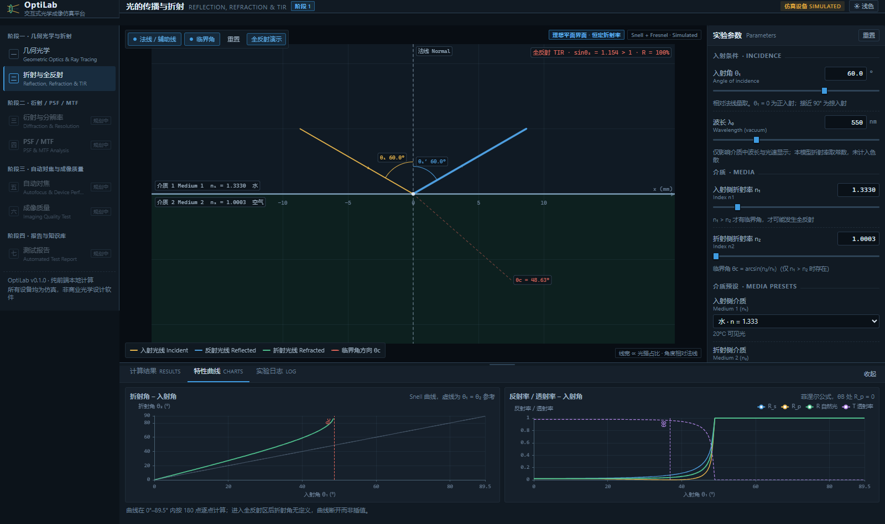 | 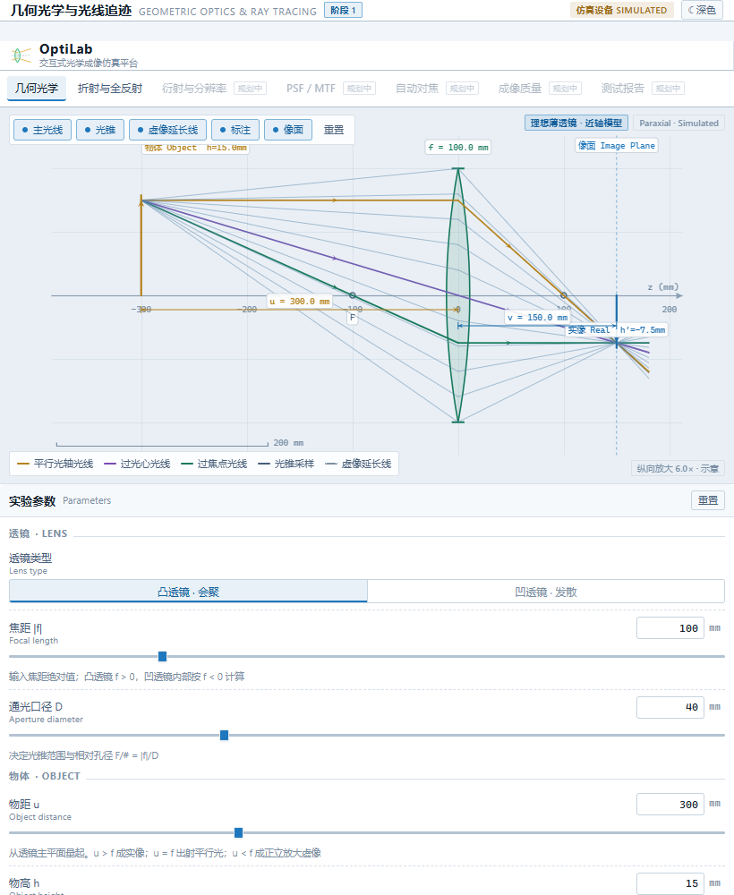 |

## 4. 技术栈

| 层次 | 选型 | 说明 |
| --- | --- | --- |
| 构建 | Vite 8 | 秒级冷启动，产物可直接静态托管 |
| 框架 | Vue 3.5（`<script setup>` + 组合式 API） | 响应式足够、心智负担低，避免引入路由等不必要的复杂度（模块切换用状态而非路由） |
| 语言 | TypeScript 6（`strict`） | 物理量单位、符号约定靠类型与命名约束 |
| 绘图 | Canvas 2D（光路/网格/标注）+ SVG（Logo） | 光路需要逐帧精确控制坐标与线型，Canvas 比 DOM/SVG 更合适 |
| 图表 | ECharts 6（按需引入） | 科学曲线、坐标轴、markLine/markPoint 标注 |
| 测试 | Vitest 5 | 光学算法纯函数化，Node 环境直接跑，无需浏览器 |
| 数值计算 | 自实现 radix-2 FFT + J₁ 贝塞尔函数 | 不引第三方数学库：便于用解析解做单元测试，也便于将来迁入 Web Worker |
| 样式 | 原生 CSS + CSS 变量（设计令牌） | 深/浅主题靠 `data-theme` 切换变量，Canvas 侧用对齐的调色板对象 |

无后端、无数据库、无付费 API、无商业软件依赖。

## 5. 系统架构

```
┌───────────────────────────── 表示层 (src/components, src/render) ─────────────────────────────┐
│  App.vue ─ AppBrand / AppTopbar / ModuleNav                                                   │
│  ExperimentWorkspace（中央画布 + 右侧参数 + 底部数据坞）                                        │
│      ├─ CanvasStage（DPR/尺寸自适应，自动追踪响应式依赖重绘）                                    │
│      ├─ ParamPanel / ParamField（Schema 驱动生成控件，含合法性兜底）                             │
│      ├─ StatGrid / ChartPanel(ECharts) / LogConsole                                           │
│      └─ render/*.ts：viewport（世界 mm → 屏幕 px，自适应缩放）、palette、draw 基元、场景绘制     │
└───────────────────────────────────────────┬──────────────────────────────────────────────────┘
                                            │ 只读：结构化计算结果
┌────────────────────────────── 编排层 (src/stores, src/modules) ──────────────────────────────┐
│  stores/theme.ts（主题令牌）  stores/log.ts（实验日志 + 节流记录）                              │
│  modules/registry.ts（模块注册表）  modules/<模块>/（params 定义、charts 配置、视图组件）         │
└───────────────────────────────────────────┬──────────────────────────────────────────────────┘
                                            │ 纯函数调用（无副作用）
┌──────────────────────────────── 核心计算层 (src/core) ───────────────────────────────────────┐
│  optics/thinLens.ts    理想薄透镜近轴成像 + 光线追迹（含虚像/无穷远/孔径遮挡）                    │
│  optics/refraction.ts  反射/折射/全反射 + 菲涅尔反射率                                          │
│  units.ts / format.ts / geometry.ts / rng.ts（带种子 PRNG）                                    │
└───────────────────────────────────────────┬──────────────────────────────────────────────────┘
                                            │ 直接 import
                                     Vitest 单元测试（64 项断言）
```

**三条硬性分层规则**

1. `core/**` 不允许 import 任何 Vue / DOM API —— 保证算法可在 Node 里被单元测试、且能迁移到 Worker 或 WASM。
2. `render/**` 只做「世界坐标 → 屏幕坐标 + 图元绘制」，不参与任何物理量计算，不允许出现硬编码的物理数值。
3. `modules/**` 只做编排：把 params 组合成 core 的输入，把 core 的输出映射成 UI 数据卡 / ECharts option。

详细说明见 [`docs/ARCHITECTURE.md`](docs/ARCHITECTURE.md)。

## 6. 数学模型概要

| 模块 | 模型 | 核心公式 | 数值验证方式 |
| --- | --- | --- | --- |
| 几何光学 | 理想薄透镜 + 近轴近似 | `1/f = 1/u + 1/v`、`m = h′/h = −v/u`、牛顿公式 `(u−f)(v−f)=f²`；名义 F 数 `N = |f|/D`、有效 F 数 `N_eff = |v|/D`（实像时 `= N(1+|m|)`） | 与解析解互校；主光线几何不变量（平行光轴光线必过 F′、过光心光线方向不变等）用断言验证 |
| 折射 | 平面界面 + 无吸收各向同性介质 | `n₁sinθ₁ = n₂sinθ₂`、`θc = arcsin(n₂/n₁)`、`θB = arctan(n₂/n₁)`、菲涅尔 `Rs/Rp` | 斯涅尔等式残差 &lt; 1e-12；正入射退化为 `((n₁−n₂)/(n₁+n₂))²`；`R+T=1`；布儒斯特角处 `Rp=0`；光路可逆 |
| 衍射 | 理想圆孔的夫琅禾费衍射 | `I(r)=I₀[2J₁(v)/v]²`、`r₁=1.22λN`、`Δ=r₁`（瑞利）、`ν_c=1/(λN)`；物方量 = 像方量 ÷ \|m\| | J₁ 对照零点/极大/级数；二维图样对称性；物方/像方换算断言；`f_c≈2NA/λ` 的近轴退化也被断言 |
| PSF / MTF | 复光瞳 + 二维 FFT | `P=circ(ρ)exp(i2πW₂₀ρ²)`、`PSF=|FT{P}|²`、`OTF=FT{PSF}/FT{PSF}(0)`；`W₂₀=Δz/(8λN²)` | W₂₀=0 时数值 PSF 与解析艾里斑对照（绝对偏差≈0.004）、数值 MTF 与解析 `(2/π)[arccos t−t√(1−t²)]` 对照（**&lt;1.5%**）、MTF50 偏差 &lt;2%、焦深判据自洽 |

完整推导、符号约定、单位表、边界条件与数值保护策略见 [`docs/OPTICS.md`](docs/OPTICS.md)。

## 7. 快速开始

环境要求：Node.js ≥ 20（开发使用 24.x），npm ≥ 10。

```bash
# 1) 安装依赖
npm install

# 2) 启动开发服务器（默认 http://localhost:5173）
npm run dev

# 3) 类型检查 + 生产构建（产物在 dist/）
npm run build

# 4) 本地预览构建产物
npm run preview

# 5) 单元测试（光学算法验证）
npm test
```

其他脚本：`npm run typecheck`（仅类型检查）、`npm run test:watch`（监听模式）。

## 8. 质量保障

| 项目 | 当前状态 |
| --- | --- |
| 类型检查 `vue-tsc --noEmit` | ✅ 0 error（`strict` + `noUnusedLocals` + `verbatimModuleSyntax`） |
| 单元测试 `vitest run` | ✅ 16 个测试文件 / **197 个用例**全部通过（含 FFT、图像处理与解析解对照） |
| 生产构建 | ✅ 通过（产物 gzip 后 JS ≈ 293 kB，CSS ≈ 6 kB） |
| 浏览器冒烟（Chrome headless + Playwright） | ✅ 无 console error / pageerror；画布内容非空（像素采样）；深浅主题、模块切换、预设、曲线、全反射演示均可操作 |
| 输入合法性 | 参数层夹取 + 核心层结构化错误 + 界面红色提示，三层兜底 |

测试用例与验证报告见 [`docs/TESTS.md`](docs/TESTS.md)。

## 9. GitHub Pages 部署

`vite.config.ts` 已设置 `base: './'`，因此产物使用相对路径，可直接部署到任意子路径（例如 `https://<user>.github.io/OptiLab/`）。

```bash
npm run build          # 生成 dist/
```

**方式 A：手动部署**

```bash
git checkout -b gh-pages
git add dist -f
git commit -m "deploy: gh-pages"
git subtree push --prefix dist origin gh-pages
```

**方式 B：GitHub Actions（推荐）**——在仓库 Settings → Pages 中把 Source 设为 *GitHub Actions*，然后添加 `.github/workflows/deploy.yml`：

```yaml
name: Deploy to GitHub Pages
on:
  push:
    branches: [main]
  workflow_dispatch:
permissions:
  contents: read
  pages: write
  id-token: write
concurrency:
  group: pages
  cancel-in-progress: true
jobs:
  build:
    runs-on: ubuntu-latest
    steps:
      - uses: actions/checkout@v4
      - uses: actions/setup-node@v4
        with:
          node-version: 20
          cache: npm
      - run: npm ci
      - run: npm test
      - run: npm run build
      - uses: actions/upload-pages-artifact@v3
        with:
          path: dist
  deploy:
    needs: build
    runs-on: ubuntu-latest
    environment:
      name: github-pages
      url: ${{ steps.deployment.outputs.page_url }}
    steps:
      - id: deployment
        uses: actions/deploy-pages@v4
```

> 无需任何服务端配置；所有计算在浏览器完成，因此没有跨域、密钥或 CORS 问题。

## 10. 项目局限

1. **理想化光学模型**：薄透镜近轴近似，不含球差/彗差/场曲/色差，不含衍射与镀膜；折射模块用恒定折射率，未做 Sellmeier 色散。
2. **显示层示意处理**：光路图纵向做有限拉伸（界面标注「纵向放大 N×」），否则行宽比十几倍的场景会被压成一条线；**所有数值结果不受显示拉伸影响**。
3. **不是设计工具**：没有优化器、没有非序列追迹、没有 Zernike 面形与公差分析。
4. **未接入真实检测模型**：第六阶段预留 ONNX 推理接口，在接入真实模型前 **不会生成任何检测准确率/漏检率**。
5. **性能边界**：当前场景在单帧内完成绘制；后续衍射/PSF 需要 FFT 大矩阵运算，届时会引入计算节流或 Web Worker。

## 11. 后续扩展建议

- **阶段二**：衍射采用贝塞尔函数解析解 `I(r) = (2J₁(v)/v)²` 绘制艾里斑（不做随机圆环伪装）；PSF/MTF 用复光瞳 `P(x,y)=circ(r)·exp(i·2π·W₂₀·r²)` 做 FFT，并用解析衍射极限曲线对照。
- **阶段三**：清晰度评价函数（Laplacian Variance / Tenengrad / Brenner）在真实像素数据上计算；Z 轴平台高斯模糊退化需显式标注为「图像退化近似模型」；随机噪声用已有带种子 PRNG（`core/rng.ts`）保证可复现；重复性统计按 `n` 次实验计算均值/标准差/最大误差/成功率。
- **阶段四**：统一实验记录 → CSV/JSON 导出 + Canvas 图表 PNG 导出 + 可打印 HTML 报告（含实验目的、理论依据、参数、结果、误差分析、结论、模型局限）。
- **工程化**：把 `core/imaging/*` 的重量级计算迁入 Web Worker；增加 Playwright E2E 与 GitHub Actions 自动部署；增加 `knowledge/` 知识库全文检索。

## 12. 学习与技术要点

这里是本项目在实现过程中真正踩过、想清楚的几个技术点，也适合作为进一步学习的索引。

1. **符号约定与边界条件**：`u = f` 时高斯公式分母为零，如何处理成「像在无穷远」而不是给一个巨大的假数值（本实现用相对容差 + 阈值判定，并给出显式警告）。
2. **虚像的几何表达**：出射光线反向延长线相交 —— 计算层直接输出带 `dashed` 标记的延长线段，渲染层只负责样式，避免渲染层做物理判断。
3. **自适应视口的取舍**：世界 mm → 屏幕 px 的等比缩放会让光路压扁，因此引入**显式标注的纵向拉伸**，并保证「显示失真不污染数值」。
4. **数据驱动可视化**：折射场景中光线线宽 = 实际反射率/透射率 → 全反射时折射光自然消失、反射光最粗，不需要额外的 if/else 特判动画。
5. **可复现性**：自己实现 mulberry32 + Box–Muller 的带种子 PRNG，替代无法设定种子的 `Math.random()`，为后续随机噪声仿真打基础。
6. **测试策略**：不与「上次输出」对比（快照会一起错），而与解析解/独立公式对比（如用牛顿公式反算、用 `R+T=1` 校核能量守恒）。
7. **响应式与 Canvas 的配合**：`watchEffect` 追踪 `draw` 内部读取的响应式参数 → 参数一变自动重绘，无需手写 watch 列表；DPR 缩放保证高分屏不糊。

---

## 许可证

MIT（仅限代码；项目中的物理模型与结论请自行按需验证）。
